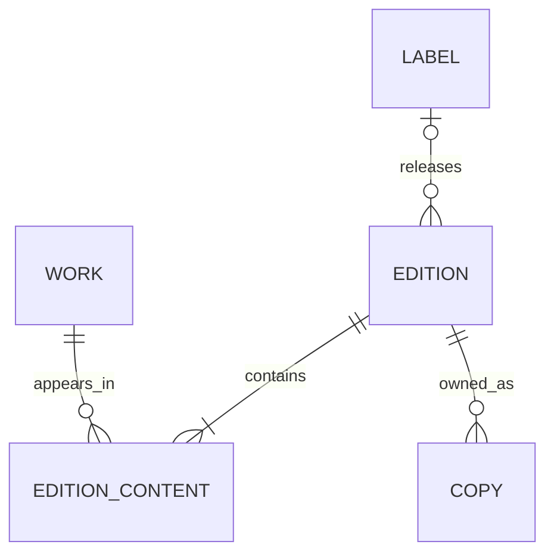

# Physical collection: model and daily use

**Integration status:** collection work records are provisional staging identities,
not a second permanent film catalogue. See [RELATIONSHIPS.md](RELATIONSHIPS.md)
for the audited plan to share canonical identities with the diary and reviews.
The first 97 work records now link to 95 existing identities; see
[applied reconciliation](../data/cinema-reconciliation/README.md).

**Edit `cinema/collection.json`, or use `scripts/collection.py`.** This is the
single source of truth. `shelf.csv`, `shelf.json` and the review queue are generated
exports: spreadsheet edits to them do **not** write back. The pre-migration CSV is
preserved at `data/film-shelf/imports/shelf-transcription.csv` as evidence.

## Why three layers?



| Layer | Belongs here | Does not belong here |
|---|---|---|
| Work | Film/series identity, original release year, optional link to the existing diary film ID | Disc label, packaging, condition |
| Edition | Release title, label, imprint, catalogue number, barcode, formats, packaging, country/release date, content list | Whether your copy is scratched; your rating |
| Edition content | Work ID, theatrical/director's cut, season/episode coverage, main/supplement role | A claim that each film in a box is a separate owned copy |
| Copy | Which edition you own, condition, location, acquisition date, ownership status, evidence/photos | A second film identity |

Examples:

- A Kino Lorber UHD and an Arrow Blu-ray can reference **the same work**, but are
  different editions. Two copies of one release share an edition ID.
- A Hitchcock box is **one edition, one owned copy, many works**. A film may also
  appear in other boxes or as a standalone edition.
- The faulty *Lifeboat* disc is a separate copy with `condition: "faulty"`.
  Its exact edition is still unidentified, so it has not been merged with the
  other *Lifeboat* release just because their titles match.
- A season set refers to a TV-series work, with coverage on the edition-content
  relationship. Broadcast season numbering and home-video release names can differ.

Existing viewing/review data stays in `films.json`, `viewings.json` and `reviews/`.
A work's optional `catalogue_film_id` links to that identity; ownership does not
imply watched, liked, rated, or a new diary entry. Collection commands never write
those files. No public website route has been added.

## Quick additions

All commands run from the repository root, offline and without an API key.

```sh
# Search first; prints edition IDs, labels, formats and constituent work IDs:
python3 scripts/collection.py search "RoboCop"
python3 scripts/collection.py search "Kino"

# A genuinely new film/release (illustrative title):
python3 scripts/collection.py add "A new film" --year 2026 \
  --label Arrow --format "4K UHD" --catalogue-number FCD0000

# A different release of a known work; substitute IDs printed by search:
python3 scripts/collection.py add "Existing film title" --work work-0123 \
  --new-edition --label Kino --format Blu-ray --packaging steelbook

# Another physical copy of exactly the same edition:
python3 scripts/collection.py copy edition-0123 --location "Living room"

# Box with new constituent titles: one owned copy, not two:
python3 scripts/collection.py add "Two-film collection" \
  --contains "First film title" --contains "Second film title" --label Arrow

# Box containing already identified works:
python3 scripts/collection.py add "Another collection" \
  --work work-0123 --work work-0456 --label Criterion

# TV: title is the series identity, coverage belongs to this edition:
python3 scripts/collection.py add "A new series" --kind tv_series \
  --coverage "Season 1, episodes 1–6" --format DVD
```

These are examples, not purchases to enter automatically. All fields except the
release title are optional; unknown values stay null/empty. Label shortcuts include
`Arrow`, `Arrow Academy`, `Kino`, `Criterion`, `Eureka` and `BFI`; custom labels also
work. Repeat `--format` for a UHD + Blu-ray package. `--barcode` stores a barcode
**as text**, preserving leading zeroes; it does not perform a barcode lookup.

An existing title is not silently merged: the command prints matching IDs and
asks you to choose another copy versus another edition. Existing work identities
must be explicitly selected. Remakes with the same title remain distinguishable
by work ID/year. `--new-edition` does not bypass barcode uniqueness checks.

## Correct and enrich

```sh
python3 scripts/collection.py show edition-0123
python3 scripts/collection.py edit edition-0123 --label "Arrow Academy" \
  --format Blu-ray --catalogue-number FCD1234
python3 scripts/collection.py set-copy shelf-0123 --condition faulty --notes "Disc freezes"
python3 scripts/collection.py set-copy shelf-0123 --location "Favourite film shelf"
python3 scripts/collection.py link work-0123 EXISTING_DIARY_FILM_ID
python3 scripts/collection.py merge-works work-0456 work-0123
python3 scripts/collection.py validate
python3 scripts/collection.py export
```

`merge-works` is an explicit assertion that the works are identical. It rewires
contents, preserves every edition/copy and retains the old work in merge history;
it rejects conflicting years, kinds or external IDs. It is **not** an edition merge.
For work titles/years, exact disc specifications, or per-film cuts in a box, edit
`collection.json` directly and validate/export. Avoid manual edits while a command
is running. CLI writers are locked; the canonical JSON is saved atomically only
after validation. Exports can be regenerated if interrupted.

## Fields and future extension

- Local IDs are permanent and independent of TMDB or any retailer. Existing
  `shelf-NNNN` IDs are retained as copy IDs.
- `labels` has canonical names and aliases. `imprint` is separate (e.g. Kino Lorber /
  KL Studio Classics, Eureka / Masters of Cinema). Studio copyright logos do not
  necessarily identify the releasing label.
- `editions.formats` is a list, not a single quality ranking. Seeing a UHD logo does
  not prove an accompanying Blu-ray exists. `discs` is reserved for optional
  per-disc records (format, region, notes); currently empty rather than guessed.
- `barcode` and `catalogue_number` are strings, not film IDs. The latter is not
  globally unique. `release_date` is the **disc release date**, unlike a work year.
- `contents[].coverage` is an object; currently its `description` preserves exact
  observed/owner wording. Structured season/episode ranges can be added later.
- `contents[].cut` distinguishes versions of the same work, not another film.
  `role` can be `main`, `supplement`, or `unspecified`. The migration leaves box
  roles unspecified rather than misclassifying documentary/short extras.
- Copy condition and ownership are independent. Unknown condition is not “good”.
  Location/acquisition information stays local unless a future public projection
  explicitly chooses to include it. Do not publish the entire source JSON blindly.
- A label/title identification is not complete edition verification. `status`
  retains the original transcription/research/owner distinction, with evidence
  and historical before/after records. Nulls mean unrecorded, not absent.

## Migration and current coverage

The initial 855 records plus 96 additional photographed packages give **951 owned
copy records** across 61 photos. New IDs are `shelf-0856` through `shelf-0951`.
Overlapping glimpses within the new photos were not counted again. Matching titles
on different shelves were retained as separate packages; no title-only copy merges.

The migration creates provisional edition/work identities, not an asserted count
of unique films or unique commercial releases. There are currently 1,172 work
records including box constituents; many deliberately await identity consolidation.
Do not advertise that number as “1,172 films”. Linked works can subsequently be
shared across editions using explicit identity confirmation.

All 68 original **identification** questions remain resolved. However, **886 copies
still lack a recorded label and/or format** (mostly from the first transcription).
The [review queue](../data/film-shelf/review.md) now makes that separate enrichment
backlog visible. Exact editions may additionally lack barcode, packaging or region.
The new photographs capture labels/imprints/catalogue numbers where readable;
no label was invented from a title alone.

`migrate-collection.py` is a one-time migration from the frozen transcription and
refuses to overwrite an existing collection. Do not use it for daily additions.
`scripts/export-shelf.py` remains as a compatibility alias for the new exporter.

## Interface choice and existing tools

The command-line workflow follows this repository's existing `cinema.py` pattern.
The model is independent of that interface: a local form can call the same
validation/storage layer without changing the data model. No browser editor or
barcode/title metadata service has been implemented yet.

Preflight considered [Libib](https://www.libib.com/) (hosted catalogue and barcode
entry) and [DiscVault](https://github.com/helmerzNL/DiscVault) (self-hosted physical
media manager). Both warrant consideration if a dedicated collection application
becomes preferable. For this existing static website, the chosen implementation
keeps editable local data alongside its diary and avoids operating/synchronising
a second catalogue. No account, service installation or paid subscription is needed.

Checks: `python3 scripts/test-collection.py`, then `python3 scripts/collection.py validate`.

## Website integration and ongoing reconciliation

`src/Cinema.hs` reads the source collection directly, so the website build does not
depend on a stale generated export. `/films/collection/` lists owned/loaned releases
with title/content search and label/format filters. Each release has a stable
`/films/collection/editions/edition-NNNN/` URL. Confirmed contents point to the
existing canonical film page, with reviews, viewing history and My editions.
Unresolved contents use `/films/collection/works/work-NNNN/` until linked; these
pages explicitly make no claim about whether the film was watched. Linking a work
moves navigation to the canonical film page without changing edition URLs.
Earlier work-page URLs remain valid and point visitors to the canonical page.
Private copy locations, acquisition data, notes and source photos are not rendered.
Unknown label/format fields remain visibly unrecorded; not guesses.

For additions not yet watched, create the film without inventing viewing history:

```sh
python3 scripts/cinema.py film --tmdb-id 123 --unwatched
# Use the printed canonical ID to link the existing collection work:
python3 scripts/collection.py link work-NNNN local-PRINTED-ID
```

`film --unwatched` does not create a viewing. TMDB credentials remain outside the
repository (`TMDB_TOKEN_FILE`, the default config path, or `--token-file`).
Prepare candidates for unlinked works without applying them:

```sh
python3 scripts/match-collection-tmdb.py --limit 100
```

The candidate report is resumable; movie and television lookups are separate.
A single search result is not sufficient proof of identity. Review year, director,
cast and the edition evidence before linking. Existing canonical matching suggestions
are in `generated/cinema-relations/unlinked-works.csv`. Avoid creating a new film
when an existing canonical identity already represents it.

Non-viewing diary notes live in `cinema/entries.json`, linked from reviews using
`diary_entry` rather than `viewing`. They must not contribute to watch counts.

## Reviewed TMDB integration (19 October 2026)

`films.json` remains the canonical source; collection works are stable links into
it. The reviewed importer reuses existing typed TMDB identities and creates
`tmdb-movie-ID` / `tmdb-tv-ID` records only where needed. Imported collection-only
records have `watched: null`, not invented viewing events or a claim of never watched.
Existing ratings, review IDs, Letterboxd references and film URLs are unchanged.

```sh
python3 scripts/integrate-collection-tmdb.py --token-file "$TMDB_TOKEN_FILE"
# After reviewing data/cinema-reconciliation/tmdb-reviewed.json:
python3 scripts/integrate-collection-tmdb.py --token-file "$TMDB_TOKEN_FILE" --apply
```

Dry-run is the default. Applying validates the proposed graph and saves a recovery
journal before updating sources. Do not run a second writer concurrently. Metadata
fetching and candidates never auto-approve a match. Future metadata refreshes must
preserve curated overrides (see Nausicaä), rather than blindly replace local data.

Current results: 951 packages; 1,104/1,108 collection records linked; 1,051 distinct
films including documentaries/TV films, excluding series, shorts, concerts and
calibration discs. This is still provisional pending the final identity questions.
The remaining work list is in `data/cinema-reconciliation/tmdb-remaining.json`.
