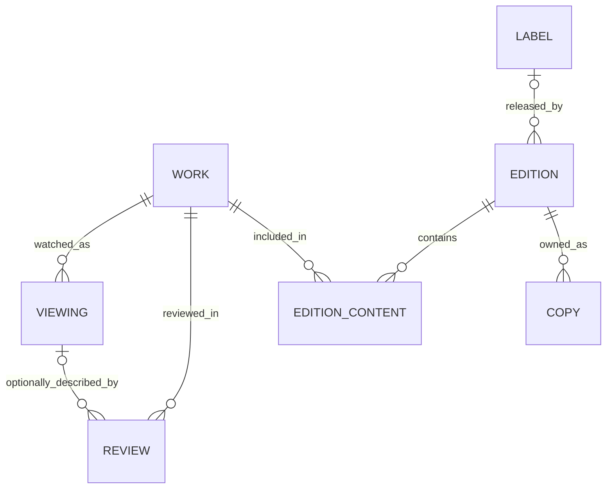

# One cinema catalogue: recommended target model

**Status: website integration implemented locally; identity reconciliation remains in progress.**
1,104 collection works now link to canonical identities (1,242 catalogue entries total). Their film pages
show holdings and link back to edition pages; unlinked works have clearly labelled
provisional collection pages instead of guessed viewing/review links.
`collection.json` remains the ownership source. Existing film/review URLs are preserved.
Two non-viewing Piano Teacher entries now live in `entries.json`; all three reviews
remain, with explicit `diary_entry` references for the first two. There are 419
actual dated viewing records, plus two preserved non-viewing notes.

## What the initial audit found (before reconciliation, 19 October 2026)

| Data | Count / finding |
|---|---|
| Canonical film catalogue | 725 identities, all marked watched |
| Dated viewings | 421 events |
| Reviews | 271, of which 270 published and one draft |
| Explicit review → viewing links | 8 |
| Additional deterministic review → viewing candidates | 246: same film ID and same Letterboxd entry URL; no watched-date conflicts |
| Collection | 951 copies/edition records, 1,172 provisional constituent work records |
| Collection → film identity links | **Zero** |
| Exact normalised title + year candidates | 13 collection work records |
| Title-only/type-unresolved candidates | 595 collection work records; not safe automatic matches |
| No exact title candidate | 564 work records; not proof the film is unwatched or absent |
| Repeated collection title groups | 63; may include remakes, translations and genuine duplicate identities |
| Watched films without dated viewing events | 345; preserve their known-watched status |
| Checked integrity | No duplicate film IDs/slugs or broken viewing/review references; no duplicate TMDB movie identities |

Regenerate the read-only report with:

```sh
python3 scripts/audit-cinema-relations.py
```

Output: `generated/cinema-relations/audit.md` and `audit.json`. Candidates are not
written back. Photo hashes and collection foreign keys are also checked. These
counts describe evidence records, **not unique owned films**.

## The recommendation

Use one canonical **work identity** per film, TV series or other identified work.
Keep the useful edition/copy separation, but replace the parallel collection work
catalogue with references to those canonical identities. Keep source files local
and Git-friendly; a server database is not required for relational data.



### Longer-term proposed sources (not the current file layout)

| Source | Role |
|---|---|
| `cinema/works.json` | Canonical identities, existing film metadata, stable IDs/slugs, typed external IDs; film/TV/short/etc. distinguished explicitly |
| `cinema/collection.json` | Labels, editions, edition contents and copies; **no duplicate work titles/years maintained here** |
| `cinema/viewings.json` | Dated events referencing canonical work IDs; optional exact edition/copy watched |
| `cinema/reviews/*.md` | Writing and review-specific metadata; canonical work reference and optional viewing reference |
| `cinema/directors.json` | External filmography snapshots, not another authoritative work catalogue |
| `cinema/artwork.json` | Artwork keyed by the same canonical work IDs |
| `cinema/films.json` | During transition only: generated compatibility projection for existing film tooling/site, never independently editable |

Existing film IDs such as `lb-2awY` and current slugs survive unchanged. IDs do not
need cosmetically renaming to `work-*`. Reviews and viewings can keep their current
`film` reference key during the film-only transition; it resolves to the same
canonical work ID. Introduce a general `work` key only with a versioned reader/writer
migration for TV, not an accidental mix of conventions.

Film-level likes, tags and overall ratings may remain properties of the canonical
work for this single-user site. No need to split every scalar into another table.
Review ratings and per-viewing ratings remain independent: neither overwrites the
other or the work-level overall rating.

### Concrete example

`Alien (1979)` already has canonical identity **`lb-2awY`**. Standalone UHD releases,
the Alien Anthology and Alien Quadrilogy should each have edition-content entries
pointing to `lb-2awY`. Its dated watches and all its reviews already use that ID.
The film page can therefore show its writing, viewing history and owned editions
without fuzzy title joins. A box-set page lists the same canonical film page,
not a new “Alien in this box” identity.

Distinct editions and physical copies stay separate even after work identities
are merged. Unknown edition details do not prevent a confirmed work relationship.
Conversely, a confidently transcribed package title does not prove which remake
or film cut it contains.

## Rules that make it coherent

1. **Stable keys, not title joins.** Titles and translations are display/search
   metadata. TMDB references are typed (`movie` vs `tv`); IDs from different namespaces
   are not interchangeable. Identity merges have an auditable old-ID → canonical-ID map.
2. **Owned, watched, reviewed and liked are independent.** Derive ownership through
   copies → editions → content. Derive watched state from dated viewing evidence
   **or the preserved legacy watched assertion**. Never invent a viewing date for
   the 345 films watched without a logged date. A review is not a substitute for a
   dated viewing event. Unknown viewing status need not claim “never watched”.
3. **Edition contents are a relationship.** They hold cut/version, season/episode
   coverage and main/supplement role. Films in a box share canonical identities with
   standalone films. TV coverage must not turn “own season 1” into “own complete series”.
4. **Do not force uncertain observations into canonical identities.** Preserve raw
   title, source photo and candidate IDs in a reconciliation/staging record. Unknown
   years, ambiguous remakes and unclassified box supplements stay explicitly unresolved.
   “No exact title candidate” is not “add a new film automatically”.
5. **Review → viewing is optional but explicit where known.** Convert the 246
   matching imported entry URLs into foreign keys after rechecking uniqueness and
   same-film constraints. Keep Letterboxd URLs as provenance, not runtime joins.
   Do not link the remaining reviews by date/title alone or create fictional watches.
6. **Optional playback provenance.** A new viewing may reference an edition or
   copy, but streaming/cinema watches need neither. If supplied, that edition must
   actually contain the viewing's work. Physical ownership does not prove which
   edition was watched; never backfill that inference.
7. **One source for each fact.** Commands, the site and exports use one resolver and
   the same validated relationships. Generated CSV/compatibility JSON are not a
   second editable catalogue. Label aliases are canonicalised independently of works.

## Website integration status

The watched-only assumptions have been fixed: director counts use actual known
watching, the interactive film command supports `--unwatched`, and collection
imports use `watched: null` for unknown history. Canonical `films.json` remains
the editable source today; the proposed works.json migration above has not been
performed. Collection index, edition pages and linked film holdings are implemented.
The following remains the wider presentation roadmap, not a claim that every
view below (such as separate label pages) is implemented.

Keep a static Hakyll site and local authoring. A shared validated build-time graph
can produce these views:

- **Existing film page:** metadata, your reviews, viewing history, and an “In my
  collection” section showing labels, editions, formats and which boxes contain it.
- **Collection index:** search/filter by film, label, format and watched status;
  distinguish “films” from “packages” counts. Default to main works, not bonus shorts.
- **Edition page:** the package itself, label/imprint, catalogue number, formats,
  verified cut/coverage details and linked constituent films.
- **Label page:** owned Arrow/Kino/etc. editions, not a separate set of film identities.
- **Director page:** independent known-watched, owned and reviewed indicators.
- **TV pages:** type-appropriate routes and season coverage; do not force TV into
  film reviews or silently treat episodes as separate feature films.

Preserve `/films/<existing-slug>/` and all nested review URLs. New owned/unwatched
film pages are useful even with no review. Provisional unidentified works should
not get guessed public slugs or inflate unique-film counts.

Build a public projection, not a raw dump of ownership data: shelf locations,
purchase details, loans, source-photo paths and private copy notes should be
omitted by default. Draft reviews remain excluded. Public edition descriptions
can be curated independently of those private copy facts.

## Migration sequence and acceptance checks

1. **Establish explicit watched semantics and graph validation.** Test an owned but
   unwatched film, a watched film without dated events, a reviewed film, and a draft.
   Existing watched/director totals must remain unchanged.
2. **Canonicalise without changing identities/URLs.** Seed `works.json` from the
   725 existing films, preserving every ID, slug, metadata field and artwork link.
   Switch all writers/readers together or use a read-only compatibility projection;
   do not operate two independent editable sources.
3. **Reconcile the collection in batches.** Review the 13 title/year candidates
   against their edition evidence first; research the larger title-only queue using
   director/year/label catalogue data. Map stubs to canonical works, preserving all
   951 copy IDs, edition relationships, notes, photo evidence and source snapshots.
   Confirm new works where appropriate; do not automatically add all 1,172 stubs.
4. **Make imported review/viewing links explicit.** Apply only unique same-work,
   same-entry-URL links with consistent dates. Leave genuinely standalone reviews
   standalone. Assert review-to-viewing work equality in validation.
5. **Build website projections and ownership panels.** Verify stable URLs, draft
   exclusion, box-set traversal, TV coverage and independent watched/owned counts.
   Keep acquisition/private-copy data out of the public output.
6. **Unify authoring.** “Add to collection” searches the canonical work and existing
   editions before creating a release/copy. “Log a viewing” searches the same work
   catalogue and optionally selects an owned edition. “Write review” links that work
   and optionally the viewing. None of these actions implies either of the others.

A SQLite database could later enforce the same foreign keys transactionally, but
moving storage now would not itself resolve the identity mismatch. The immediate
priority is shared identity, explicit relations and one validated source per fact.
